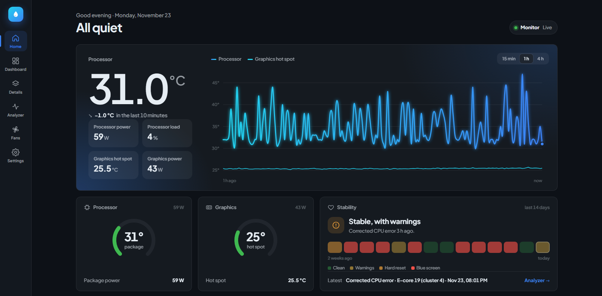
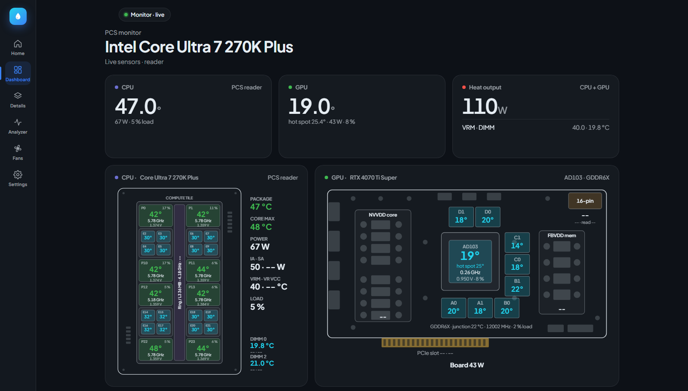
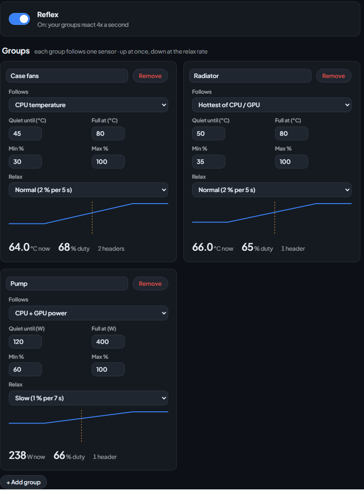
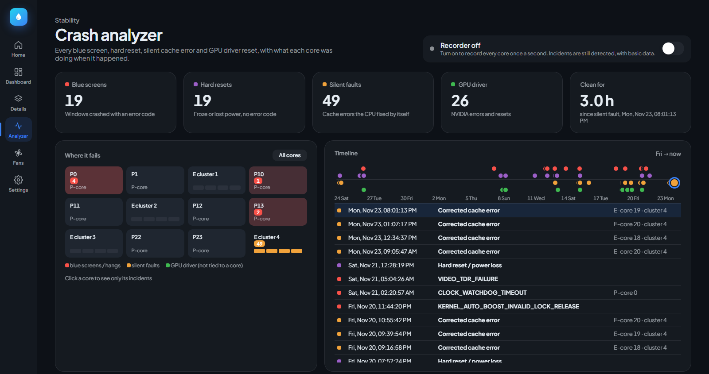

  

  
  
  

  <b>See what your PC is really doing.</b> 
  Every core, the GPU, the board and every fan, live. Fans that react in a quarter of a second. 
  And when it crashes, PCS tells you where and why.

> [!WARNING]
> **Very early alpha.** Expect bugs, missing sensors and crashes. Reflex (fan control) has only been tested on a few
> PCs: watch your temperatures the first time you turn it on, and switch it off in the Fans tab if anything looks
> wrong. Use at your own risk, no warranty.

  

## Live sensors

Every core with its temperature, clock, voltage and load, drawn on the chip itself. The GPU with its memory chips, the
board with every fan header, and the drives. No HWiNFO needed: PCS has its own sensor reader, which uses around 4 % of
one core.

  

## Reflex

<table>
  <tr>
    <td width="50%">
      
Name your fans, group them, and let each group follow what matters: CPU or GPU temperature, power draw, or
      any sensor in your PC.

      
<b>Fast.</b> Reflex reads the CPU four times a second and ramps up in the same moment the load hits, then eases
      back down quietly.

      
<b>Simple.</b> Two numbers instead of a curve editor: <i>quiet until</i> and <i>full at</i>.

      
<b>Identify.</b> Spins one header at full speed for a few seconds, so you know which fan is which.

      
<b>Safe.</b> Off until you switch it on. If a sensor goes quiet, another fan tool takes over or PCS stops,
      every fan falls back to its BIOS curve.

    </td>
    <td width="50%"></td>
  </tr>
</table>

## Crash analyzer

Blue screens, hard resets, silent CPU cache errors and GPU driver resets in one timeline. For each one PCS shows which
core it hit and what the PC was doing in the two minutes before. Turn on the flight recorder for the full picture:
every core, once a second, kept across reboots. Made for overclockers chasing that last unstable core.

  

## Install

1. Download **`PCS-Setup-x.y.z.exe`** from **[Releases](../../releases/latest)**.
2. Run it and click **Install**. Windows asks for administrator rights, which the sensor reader needs to read the CPU
   and motherboard.
3. If the **PawnIO** driver isn't installed yet, setup offers it. It's the signed, open-source driver that FanControl
   and LibreHardwareMonitor use too.

PCS updates itself from this page: you get a notification in the tray when a new version is out.

**Requirements:** Windows 10 or 11, 64-bit. Intel and AMD CPUs, NVIDIA and AMD GPUs.

<b>Windows or my antivirus blocks it</b>

PCS isn't code-signed yet. Windows SmartScreen may warn: click **More info → Run anyway**. Some antivirus tools,
especially Norton, may close it. Add `C:\Program Files\PCS` and `C:\ProgramData\PCS` as exclusions.

<b>Uninstall</b>

Settings → Apps → Installed apps → **PCS** → Uninstall. Every fan goes back to its BIOS curve. PawnIO stays
installed because other tools use it; remove it there too if you like.

<b>Known limits</b>

- Some readings need sensors your hardware may not have; those simply don't show.
- AMD Ryzen 7000 / 9000 report one temperature per chiplet, not per core.
- Reflex drives motherboard fan headers and GPU fans. USB fan hubs and AIO pumps (Corsair, NZXT, Lian Li) aren't
  supported yet.
- Laptops: monitoring only; their fans are usually locked by the manufacturer.

## Privacy

Nothing is sent anywhere. PCS runs entirely on your PC; its service only listens on `127.0.0.1`. The only outside
connection is the update check against this page.

## Feedback

Found a bug or a sensor that's wrong? Open an **[issue](../../issues)** with your CPU, GPU and motherboard model and a
screenshot.
